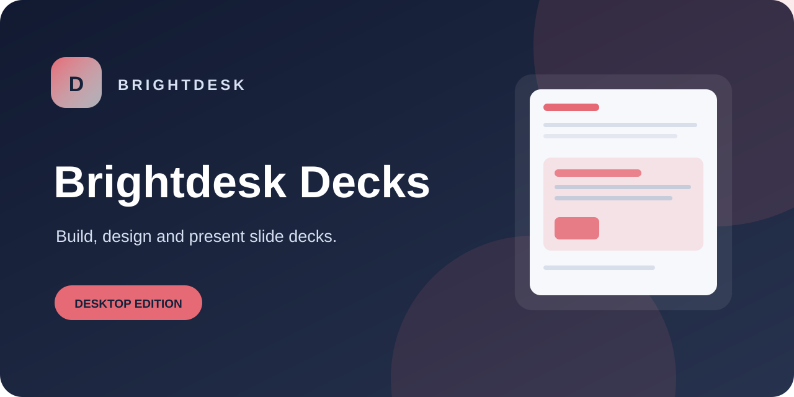
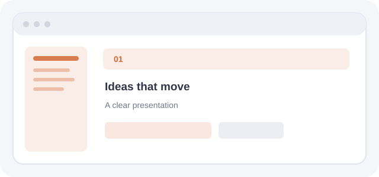

# Brightdesk Decks

Build, design and present slide decks.

Brightdesk is an independent desktop product. This repository is the dedicated desktop edition of **Brightdesk Decks**. It opens directly into Decks, with product switching disabled.

## What this product does

Create slide presentations with familiar presentation and layout tools.

## Desktop installers

| Platform | Installer |
| --- | --- |
| Windows | Windows x64 installer (.exe) |
| macOS | Universal installer (.dmg), package (.pkg) and archive (.zip) |
| Linux | x64 AppImage and Debian package (.deb) |

Installers are built and verified by this repository's release workflow. Publishing a GitHub Release is a separate manual choice and is disabled by default.

The complete ten-product desktop suite remains available from [Brightdesk-suite](https://github.com/connormolloy12/Brightdesk-suite).

## Quality and security

Pull requests and pushes run the product and shared-engine test suite, verify the dependency lock and third-party licences, check release preflight and block high-severity dependency vulnerabilities. The same checks repeat daily. Dependabot checks npm packages and GitHub Actions weekly.

## Run from source

Use Node.js **24.22.2**.

    npm ci
    npm start

To build and verify an installer on its native operating system:

    npm run dist:product:mac
    npm run verify:product:mac

Use win on Windows or linux on Linux instead of mac.

## Project structure

- src/ — Brightdesk desktop renderer and product modules.
- assets/brightdesk-product.svg — original Decks artwork.
- scripts/ — build and release verification tools.
- tests/ — automated product and shared-engine tests.

## Related project

[Brightdesk Office Suite](https://github.com/connormolloy12/Brightdesk-suite) brings all ten approved Brightdesk products together in one desktop installer.

## Identity and licence

Brightdesk is independent and is not affiliated with Microsoft. It uses original product names, code, interface design and artwork. See LICENSE, TERMS_AND_CONDITIONS.txt and THIRD_PARTY_NOTICES.md.

## Rust foundation

This repository now includes an additive Rust core foundation in `rust/`, pinned to Rust 1.99.1. The first Rust layer defines a small, versioned host contract and is checked separately from the existing Node.js application tests. Brightdesk remains an Electron desktop application: no existing JavaScript feature, installer, npm dependency, lockfile or customer-facing version has been changed, and no Rust binary is shipped in this stage. The same integration standard will be used for the four future app repositories. The shared Rust library also implements and tests Unicode-aware character, word and line counting. This is real Rust source code, but it remains a separately tested core library until the native Electron/Node bridge is built and verified. See [the Rust integration standard](docs/RUST-INTEGRATION.md) and the [official Rust getting-started guide](https://rust-lang.org/learn/get-started/).
