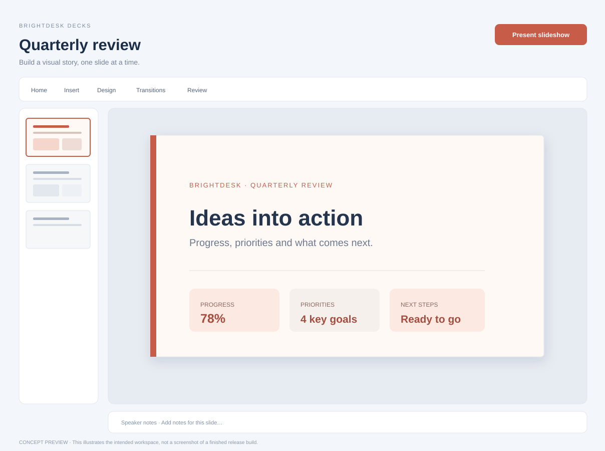

# Brightdesk Decks

<p align="center"><br><strong>brightdesk</strong></p>
<p align="center"></p>

<p align="center"><strong>Build, design and present slide decks.</strong></p>

<p align="center"><a href="https://raw.githubusercontent.com/connormolloy12/Brightdesk-Decks/main/src/branding/previews/slides.svg"></a></p>

<p align="center"><sub>Select the preview to open the full-size artwork.</sub></p>

> **Concept artwork — not a screenshot.** The preview above is original Brightdesk design artwork, not a capture from the running desktop build. A genuine screenshot will be added only after the current product window has been launched and its primary workflow checked.

Brightdesk Decks is a dedicated desktop application within the independent Brightdesk Office Suite. It uses the shared Brightdesk design language and opens directly into Decks.

## Shared Brightdesk design standard
This product follows its local [approved design brief](docs/BRIGHTDESK_DESIGN.md) and the canonical [Brightdesk visual and interaction standard](https://github.com/connormolloy12/Brightdesk-suite/blob/main/docs/BRIGHTDESK_VISUAL_STANDARD.md). Its approved accent is `#C47A2D`; the shared shell, original SVG identity, accessibility and screenshot evidence rules remain common across the suite.

## Current first-use workflows

- Create a presentation and edit slide titles and body text.
- Add, duplicate and delete slides.
- Choose from the included basic slide themes.
- Start presentation mode from the current deck.
- Import and export supported PowerPoint files; unsupported advanced objects and formatting may not be preserved.

**Known boundaries:** Decks is an early slide-editor foundation. Advanced layouts, transitions, embedded media, animation and full PowerPoint round-trip fidelity are not promised.
## Cross-platform desktop packages

The approved cross-platform target is one Brightdesk interface and product scope on Windows, macOS and Linux. Each product must retain its approved icon and accent across those systems. Only operating-system integrations such as window chrome, native dialogs, keyboard conventions, permissions and packaging may vary.

| Platform | Configured package target |
| --- | --- |
| Windows | x64 NSIS installer (.exe) |
| macOS | Universal disk image (.dmg), package installer (.pkg) and archive (.zip) |
| Linux | x64 AppImage (.AppImage) and Debian package (.deb) |

These are configured build targets, not confirmation that installers are published or have passed native verification. Build and verify each package on its target operating system before describing it as available. Release checks must cover installation, first launch, upgrade, launch after upgrade and removal. Removing Brightdesk must not silently delete local project data.

The customer-facing release version and release approval are managed centrally by Brightdesk Office Suite. Publishing remains a separate manual action.
## Quality and security

Pull requests and pushes run the product and shared-engine test suite, verify the dependency lock and third-party licences, check release preflight and block high-severity dependency vulnerabilities. The same checks repeat daily. Dependabot checks npm packages and GitHub Actions weekly.

## Run from source

Use Node.js **24.22.2**.

```sh
npm ci
npm start
```

Build and verify each installer on its matching native operating system:

| Platform | Build command | Verification command |
| --- | --- | --- |
| Windows | `npm run dist:product:win` | `npm run verify:product:win` |
| macOS | `npm run dist:product:mac` | `npm run verify:product:mac` |
| Linux | `npm run dist:product:linux` | `npm run verify:product:linux` |

## Project structure

- src/ — Brightdesk desktop renderer and product modules.
- `src/branding/icons/decks.svg` — original Brightdesk Decks application icon.
- `src/branding/previews/slides.svg` — workspace concept preview.
- scripts/ — build and release verification tools.
- tests/ — automated product and shared-engine tests.

## Related project

[Brightdesk Office Suite](https://github.com/connormolloy12/Brightdesk-suite) brings all ten approved Brightdesk products together in one desktop installer.

## Identity and licence

Brightdesk is independent and is not affiliated with Microsoft. It uses original product names, code, interface design and artwork. See LICENSE, TERMS_AND_CONDITIONS.txt and THIRD_PARTY_NOTICES.md.
